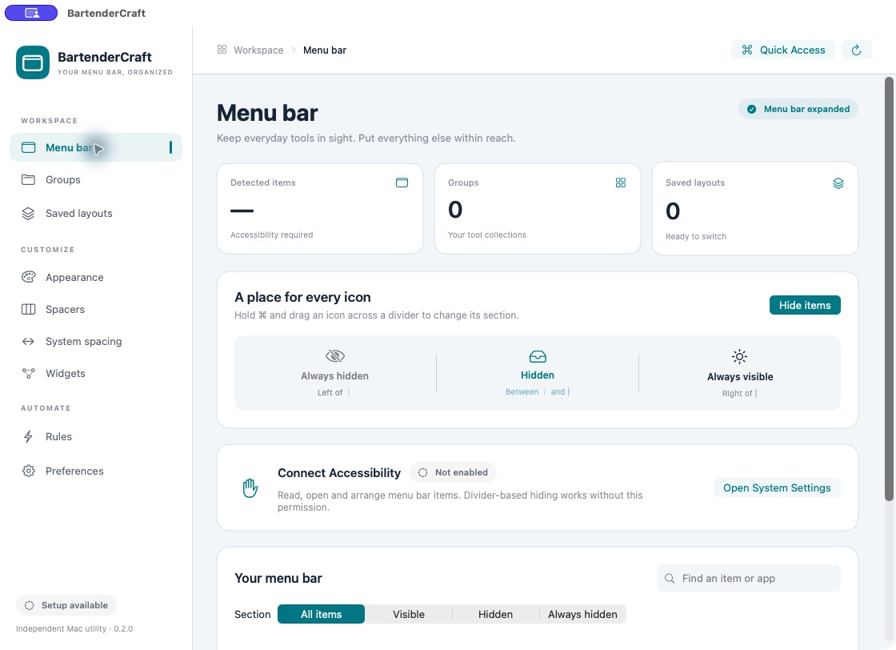
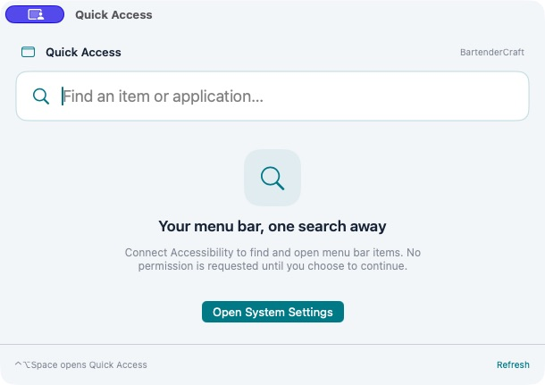

# BartenderCraft

A native menu bar workspace for macOS. Keep essential icons visible, bring related tools into groups, and switch between saved layouts.

BartenderCraft is an independent application, not affiliated with Bartender. Its interface and icon are original; it does not include Bartender code or artwork.

## Your menu bar, organized

- **Menu bar workspace:** clear visibility sections, item search, section filters and explicit setup status.
- **Quick Access:** search and open menu bar items from a compact floating panel.
- **Groups and spacers:** dedicated group shortcuts, ordered members and adjustable gaps.
- **Saved layouts:** preserve visibility, item order, groups, spacers, widgets and appearance.
- **Rules:** apply a saved layout by time, frontmost app or battery level.
- **Widgets:** connect clock, battery, text, calculation, condition and chart nodes to a menu bar output.
- **Appearance:** preview colors, gradients, corners and borders; return to the system appearance at any time.
- **Preferences:** explicit Accessibility and optional Screen Recording setup, login startup and automatic hiding.

Version **0.2.0 / build 2** defaults to English and introduces a complete English interface with shared Craft navigation, cards, previews, a new icon and redesigned Quick Access.

## Screenshots

These are actual app captures with Accessibility not enabled. They show setup and empty states, not successful automatic item movement.





## Use

Open `BartenderCraft.app`. The settings window explains the current state without requesting permissions automatically.

Hold **Command** and drag icons across the menu bar dividers: right of `│` stays visible, between `┊` and `│` hides when collapsed, and left of `┊` is always hidden. Click the BartenderCraft menu bar control to show or hide; right-click for its menu, or Option-click for settings.

**Control–Option–B** toggles hidden items. **Control–Option–Space** opens Quick Access. Shortcut registration failures are shown explicitly.

Accessibility is required to read, open and arrange actual menu bar items. Screen Recording is optional and only enables icon thumbnails; application icons are the fallback. System spacing affects all apps and is changed only by choosing **Back up & apply**. Some apps must be restarted to reflect that setting.

## Compatibility and current boundaries

The app requires macOS 14 or later. The appearance overlay requires macOS 26 or later. Actual verification is on Apple silicon; an Intel release has not been verified.

The bundle identifier, configuration location, existing item identifiers, saved-layout schema and menu bar autosave names remain compatible with BarGarden. User titles and stored data are not translated. Existing data continues at `~/Library/Application Support/BarGarden/configuration.json`.

During the current UI acceptance run, Accessibility was not granted. Automatic item movement, opening third-party menu items and full layout restoration therefore remain unverified on the delivered build. All nine settings destinations and Quick Access were visually reviewed; that does not establish successful item management.

The UI reports real permission and item availability. New Developer ID signing does not automatically grant Accessibility or Screen Recording. Prior gaps in physical dragging, full third-party layout restoration, some hotkey/device journeys and newly-created item positioning are not resolved merely by this redesign. Missing geometry and failed move verification remain explicit failures. A visual preview is an illustration, not evidence that a system appearance or spacing change has been applied.

## Build and check

Use the installed Swift 6 toolchain and Apple Command Line Tools; no third-party package dependencies are required.

```sh
swift run BarGardenCoreChecks
bash scripts/build.sh
```

Output: `build/BartenderCraft.app`. `BARTENDERCRAFT_APP_OUTPUT` can select a separate build destination. The local build script uses an ad-hoc signature; released packages must separately pass Developer ID signing, Apple notarization, ticket stapling and archive verification.

The core checks cover configuration round trips, layout planning, groups, spacers, appearance, rules, widget evaluation and global-spacing recovery. Screenshots and signed distribution results are separate acceptance evidence. No user configuration or credentials belong in source control.
